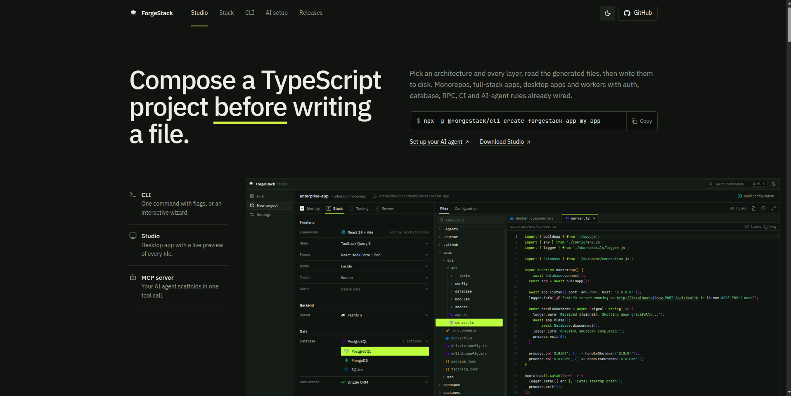
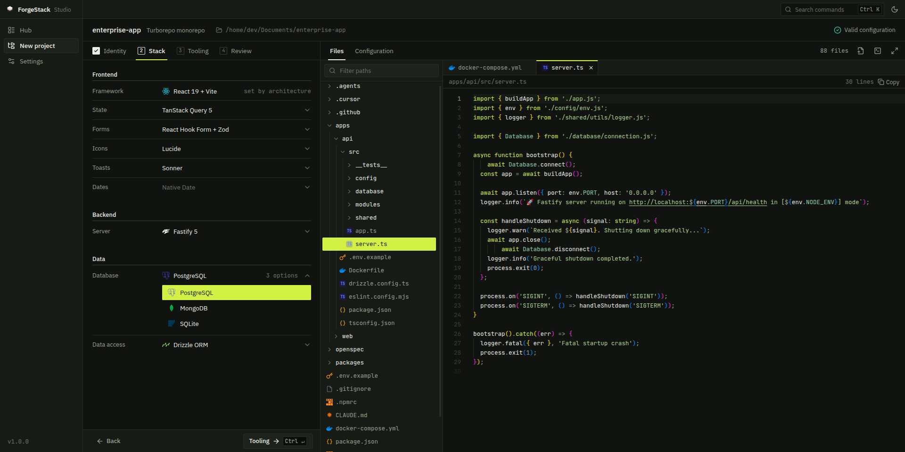
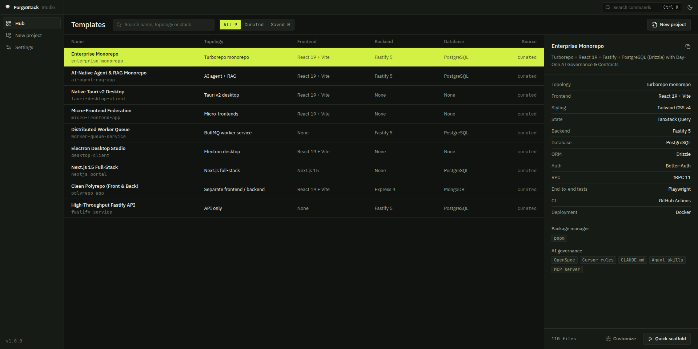
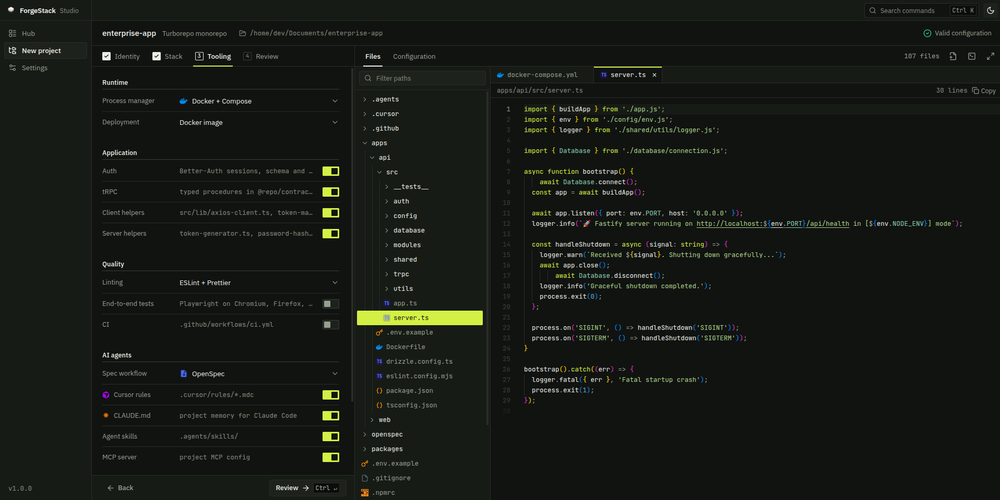
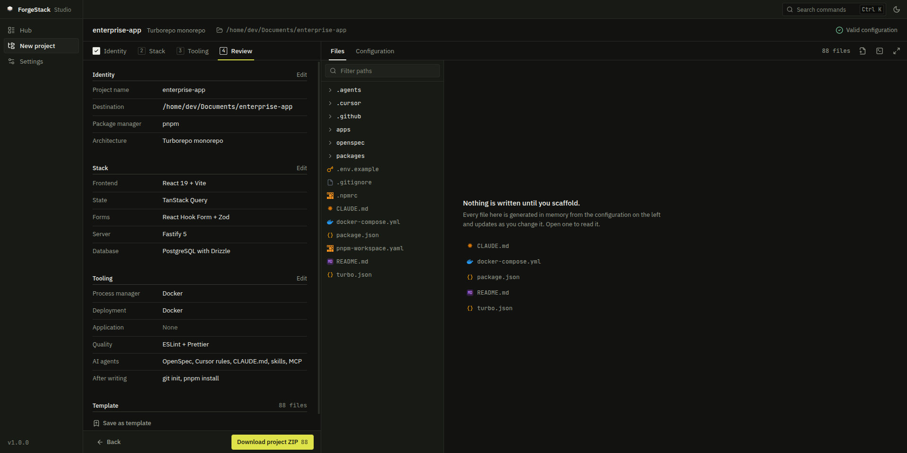

<div align="center">


# ForgeStack

**Production-ready TypeScript projects in one command, verified to build, run and lint.**

Monorepos, full-stack apps, desktop apps and workers, with auth, database, RPC, CI and AI-agent rules already wired.
Use it from the terminal, a desktop app, or let your AI assistant do it for you.

[](https://github.com/umesh-saini/forgestack/actions/workflows/ci.yml)
[](https://www.npmjs.com/package/@forgestk/cli)
[](LICENSE)
[](https://github.com/umesh-saini/forgestack)

[Website](https://umesh-saini.github.io/forgestack/) · [Quick start](#-quick-start) · [AI setup](#-use-it-from-your-ai-assistant) · [Supported stack](#-supported-stack) · [Changelog](CHANGELOG.md)



</div>

> ⭐ **If ForgeStack saves you an afternoon, please [star the repo](https://github.com/umesh-saini/forgestack).** It's free, takes one click, and helps other developers find it.

---

## 🚀 Quick start

No global install needed:

```bash
npx -p @forgestk/cli create-forgestack-app my-app
```

That opens an interactive wizard. Prefer one shot with recommended defaults?

```bash
npx -p @forgestk/cli create-forgestack-app my-app --yes
cd my-app && pnpm dev
```

> **Why `-p`?** The package ships two programs (`create-forgestack-app` and the `forgestack-mcp` AI server), so npm needs to be told which one to run. Installing globally gives you the short form:
>
> ```bash
> npm i -g @forgestk/cli
> create-forgestack-app my-app     # or: forgestack my-app
> ```

---

## ✨ Why ForgeStack

| | |
|---|---|
| **Verified, not just generated** | Every one of **~636,000** option combinations is checked on every push for broken imports, missing dependencies and invalid scripts. A pairwise sample of ~100 projects is installed, built, linted, unit-tested, migrated against real Postgres/MongoDB/Redis, **started**, and probed over HTTP, including a real sign-up and sign-in. |
| **Compose, don't clone** | Projects are assembled in memory from small feature slices, so any combination works and nothing goes stale like a template repo. Nothing touches disk until the whole tree is valid. |
| **Wired end to end** | Better-Auth sign-up/sign-in, tRPC routers, Drizzle/Prisma migrations and BullMQ workers are mounted and working, not left as TODOs. |
| **Built for AI agents** | A local MCP server lets Claude Code, Codex, Antigravity and others scaffold for you in one tool call. Every project ships rules and skills for **40 AI coding tools**. |
| **Any package manager** | pnpm, npm, yarn and bun monorepos get the right workspace setup and build-script allow-lists. |

---

## 💸 Save tokens and time

Asking an AI agent to set up a project from zero means it writes dozens of files, installs, hits build errors and fixes them, re-sending its whole context at every step. With ForgeStack it makes **one tool call**.

| Project | AI from scratch | Time | With ForgeStack |
|---|---|---|---|
| Standalone frontend or API (~25 files) | ~150k – 600k tokens | 15 – 45 min | **~2k – 5k tokens · < 1 min** |
| Next.js full-stack with auth + database (~25 files) | ~300k – 1M tokens | 30 – 90 min | **~2k – 5k tokens · < 1 min** |
| Monorepo: React + API + DB + auth + tRPC + CI (80–90 files) | ~800k – 3M+ tokens | 1 – 4 h | **~3k – 6k tokens · < 1 min** |

<sub>Estimates. How we got them: the generated code alone is **2k–15k tokens of output** (measured across the 8 curated templates; ~40k–53k including the AI-governance files). Agent sessions process far more than they output (typically 10–100×) because context is re-sent on every step and build errors take several fix loops. Your numbers depend on the model, prompt caching and the stack. The ForgeStack column is the MCP tool call plus the agent reading the summary.</sub>

---

## 🤖 Use it from your AI assistant

ForgeStack includes **`forgestack-mcp`**, a local [Model Context Protocol](https://modelcontextprotocol.io) server. It needs no account, no API key and makes no network calls. It gives your assistant five tools:

| Tool | What it does |
|---|---|
| `forgestack_list_presets` | List curated and saved templates |
| `forgestack_get_stack_options` | All supported topologies, frameworks, databases, ORMs, … |
| `forgestack_validate_config` | Check a config before generating (catches impossible combos) |
| `forgestack_preview_vfs` | Show the full file tree in memory, without writing anything |
| `forgestack_scaffold_project` | Generate the project on disk |

### Step 1: Add the MCP server (globally, recommended)

Add it **once at user/global level** and every AI session, in every project, can scaffold for you.

<details open>
<summary><b>Claude Code</b></summary>

```bash
claude mcp add --scope user forgestack -- npx -y -p @forgestk/cli forgestack-mcp
```
`--scope user` makes it available in every project. Check with `claude mcp list`.
</details>

<details open>
<summary><b>Codex (OpenAI)</b></summary>

```bash
codex mcp add forgestack -- npx -y -p @forgestk/cli forgestack-mcp
```
Or add it to `~/.codex/config.toml` (global):
```toml
[mcp_servers.forgestack]
command = "npx"
args = ["-y", "-p", "@forgestk/cli", "forgestack-mcp"]
```
</details>

<details open>
<summary><b>Antigravity</b></summary>

Agent panel → **⋯** → **MCP Servers** → **Manage MCP Servers** → **View raw config**, then add:
```json
{
  "mcpServers": {
    "forgestack": { "command": "npx", "args": ["-y", "-p", "@forgestk/cli", "forgestack-mcp"] }
  }
}
```
</details>

<details>
<summary><b>Cursor</b> · <b>Gemini CLI</b> · <b>Windsurf</b> · other tools using the same JSON format</summary>

Add the same `mcpServers` entry as Antigravity above to your tool's **global** config file:

| Tool | Global config file |
|---|---|
| Cursor | `~/.cursor/mcp.json` |
| Gemini CLI | `~/.gemini/settings.json` |
| Windsurf | `~/.codeium/windsurf/mcp_config.json` |
| Claude Desktop | `claude_desktop_config.json` (Settings → Developer → Edit Config) |

</details>

<details>
<summary><b>VS Code (GitHub Copilot)</b></summary>

```bash
code --add-mcp '{"name":"forgestack","command":"npx","args":["-y","-p","@forgestk/cli","forgestack-mcp"]}'
```
</details>

> Config file locations change between tool versions. If one above doesn't work, search your tool's docs for "MCP server"; the command is always `npx -y -p @forgestk/cli forgestack-mcp`.

### Step 2: Ask in plain language

```text
Use the forgestack MCP tools to scaffold a pnpm monorepo called "shop" with React,
Fastify, PostgreSQL + Drizzle, Better-Auth and tRPC in ~/code/shop, then install dependencies.
```

The agent validates the config, previews the tree if you ask, and writes the project, usually in a single call.

### Optional: install the ForgeStack skill

Skills teach the agent ForgeStack's flags and conventions, which is useful even without MCP. Install them globally for Claude Code and Codex:

```bash
npx -p @forgestk/cli forgestack init-skills ~ --tools claude,codex
```

Or inside a project, for any of the 40 supported tools (it auto-detects the ones you use):

```bash
npx -p @forgestk/cli forgestack init-skills .            # detected tools
npx -p @forgestk/cli forgestack init-skills . --all      # all 40
```

<details>
<summary><b>All 40 supported AI coding tools</b></summary>

Shared `.agents` skills · Antigravity · Amazon Q Developer · Auggie (Augment CLI) · Bob Shell · Claude Code · Cline · Command Code · CodeArts · Codex · Devin Desktop (formerly Windsurf) · ForgeCode · CodeBuddy Code (CLI) · Continue · CoStrict · Crush · Cursor · Factory Droid · Gemini CLI · GitHub Copilot · Hermes Agent · iFlow · Junie · Kilo Code · Kimi Code · Kiro · Lingma · MiniMax Code · Mistral Vibe · Oh My Pi · OpenCode · Pi · SourceCraft Code Assistant · Qoder · Qwen Code · Rovo Dev CLI · Zoo Code · Trae · Zed Agent · ZCode

</details>

---

## 🧰 Supported stack

Mix and match any layer. Impossible combinations (e.g. SQLite + Mongoose) are rejected with a clear message.

| Layer | Options |
|---|---|
| **Architecture** | Turborepo monorepo · AI agent + RAG (pgvector) · Micro-frontends (Module Federation) · Next.js full-stack · Separate frontend/backend · Standalone frontend · Standalone API · BullMQ worker service · Tauri v2 desktop · Electron desktop |
| **Frontend** | React 19 + Vite · Next.js 15 · Tailwind CSS v4 |
| **State** | TanStack Query · Redux Toolkit · Zustand |
| **UI kits** | Icons: Lucide, Tabler, React Icons, Phosphor · Toasts: Sonner, React-Toastify, React Hot Toast · Forms: React Hook Form + Zod, TanStack Form, Formik + Yup · Dates: Day.js, date-fns, Moment |
| **Backend** | Fastify 5 · Express · Hono |
| **Database & ORM** | PostgreSQL + Drizzle or Prisma · SQLite + Drizzle · MongoDB + Mongoose |
| **Auth, RPC, jobs** | Better-Auth · tRPC v11 · BullMQ + Redis |
| **Quality** | Vitest · Playwright · Cypress · ESLint 9 · Biome · GitHub Actions |
| **Deploy** | Docker / Compose · Vercel · Cloudflare · Railway · Fly.io |
| **Package managers** | pnpm · npm · yarn · bun |
| **AI governance** | Cursor rules · OpenSpec / GSD / Spec Kit workflows · 17 agent skills · project MCP server · `CLAUDE.md` |

### Curated templates

| Template | What you get |
|---|---|
| `enterprise-monorepo` | Turborepo, React 19, Fastify, PostgreSQL (Drizzle), Better-Auth, tRPC, Playwright, CI |
| `ai-agent-rag` | Monorepo with pgvector embeddings, OpenAI tool-calling agent, streaming chat, MCP server |
| `nextjs-fullstack` | Next.js 15 App Router, PostgreSQL (Drizzle), Better-Auth, Tailwind v4 |
| `tauri-desktop` | Tauri v2 (Rust) + React 19 + Tailwind v4 |
| `micro-frontend` | Vite Module Federation shell (:5000) + remote (:5001) + typed event bus |
| `distributed-worker` | Fastify producer + BullMQ worker + Redis, Dockerized |
| `standalone-fe` | React 19 SPA with Vite, Tailwind, TanStack Query, icons and toasts |
| `standalone-be` | Clean modular Fastify API with PostgreSQL (Drizzle), Pino, Zod env validation |

---

## ⌨️ CLI examples

```bash
# Interactive wizard
npx -p @forgestk/cli create-forgestack-app my-app

# Into the current folder (like create-next-app .)
npx -p @forgestk/cli create-forgestack-app . --yes

# From a curated template
npx -p @forgestk/cli create-forgestack-app my-app --template nextjs-fullstack

# Pick every layer yourself
npx -p @forgestk/cli create-forgestack-app my-api \
  --topology standalone-be --be hono --db postgres --orm drizzle \
  --auth better-auth --linter biome --pm npm --yes

# Preview the file tree without writing anything
npx -p @forgestk/cli create-forgestack-app my-app --yes --dry-run

# Save your stack as a reusable template, then reuse it
npx -p @forgestk/cli create-forgestack-app my-api --topology standalone-be --save-template team-api --yes
npx -p @forgestk/cli create-forgestack-app service-2 --template team-api

# Manage templates
npx -p @forgestk/cli forgestack template list
npx -p @forgestk/cli forgestack template delete team-api
```

<details>
<summary><b>All flags</b></summary>

| Flag | Description | Values (default) |
|---|---|---|
| `[dir]` | Project name or `.` for the current folder | |
| `-y, --yes` | Skip prompts, use recommended defaults | |
| `-t, --template <name>` | Curated or saved template | `enterprise-monorepo`, `nextjs-fullstack`, … |
| `--save-template <name>` | Save this configuration for reuse | |
| `--topology <type>` | Architecture | `monorepo`, `ai-agent-rag`, `micro-frontend`, `nextjs-fullstack`, `standalone-fe`, `standalone-be`, `distributed-worker`, `tauri-desktop`, `electron-desktop` |
| `--fe <framework>` | Frontend | `react-vite`, `nextjs`, `none` |
| `--styling <type>` | Styling | `tailwind`, `none` |
| `--state <type>` | State | `query`, `redux`, `zustand`, `none` |
| `--be <framework>` | Backend | `fastify`, `express`, `hono`, `none` |
| `--db <database>` | Database | `postgres`, `mongodb`, `sqlite`, `none` |
| `--orm <orm>` | ORM / ODM | `drizzle`, `prisma`, `mongoose`, `none` |
| `--auth <provider>` | Auth | `better-auth`, `none` |
| `--rpc <protocol>` | RPC (monorepos) | `trpc`, `none` |
| `--queue <type>` | Background jobs | `bullmq`, `none` |
| `--testing <framework>` | E2E tests (alias `--e2e`) | `playwright`, `none` |
| `--ci <provider>` | CI | `github-actions`, `none` |
| `--linter <type>` | Linter / formatter | `eslint` (default), `biome`, `none` |
| `--deploy <target>` | Deployment descriptor | `docker` (default), `vercel`, `cloudflare`, `railway`, `fly`, `none` |
| `--pm <manager>` | Package manager | `pnpm` (default), `npm`, `yarn`, `bun` |
| `--install / --no-install` | Install dependencies (on with `--yes`) | |
| `--git / --no-git` | Initialize a git repo | on |
| `--rules`, `--skills`, `--openspec`, `--mcp`, `--claude` | AI governance pieces (`--no-…` to skip) | on |
| `--init-ai-skills` | Also install ForgeStack skills for detected AI tools | |
| `--container / --no-container` | Dockerfile + Compose | on |
| `--force` | Allow a non-empty target folder | |
| `--dry-run` | Generate in memory only | |

</details>

---

## 🖥️ Desktop studio

A Tauri v2 desktop app: configure on the left, read the generated project on the right. Curated templates, four stages (Identity, Stack, Tooling, Review), a live in-memory file tree with a read-only editor, and a dark and a light theme. Download it from [Releases](https://github.com/umesh-saini/forgestack/releases).



| Templates | Tooling | Review |
|---|---|---|
|  |  |  |

```bash
pnpm desktop:web     # UI in the browser at http://localhost:1420 (no Rust needed)
pnpm desktop:dev     # native window (needs the Rust toolchain)
pnpm desktop:build   # installers: .deb/.AppImage, .dmg, .msi/.exe
```

---

## 🧪 How it's verified

| Level | What it proves | Command | Runs |
|---|---|---|---|
| Unit tests | Each slice emits what it promises | `pnpm test` | every push |
| Static combination matrix | All ~636k combinations of interacting options: imports resolve, dependencies are declared, scripts' binaries exist, workspace and package-manager settings are valid | `pnpm test:matrix` | every push |
| Curated templates | All 8 presets install, **build** and typecheck | `pnpm verify:templates` | every push |
| Runtime matrix | ~100 pairwise projects installed, built, typechecked, linted, unit-tested, migrated against real databases, **started** and probed over HTTP (health, sign-up, sign-in, tRPC, Vite preview, BullMQ worker) | `pnpm matrix:runtime` (Docker) | nightly |

The option space lives in [`scripts/matrix/space.mjs`](scripts/matrix/space.mjs). Add an option there and every level picks it up.

---

## 🏗️ How it works

```text
packages/
├── core/      # Engine: config schema, in-memory file system, feature slices, pipeline
├── cli/       # create-forgestack-app + forgestack-mcp (MCP server)
├── desktop/   # Tauri v2 studio
└── website/   # Project website (GitHub Pages)
```

1. Your choices become a `ProjectConfig`, which is validated and normalized (e.g. a frontend-only topology never gets backend files).
2. ~30 **feature slices** (React, Fastify, Drizzle, Better-Auth, tRPC, Docker, …) each add or patch files in an **in-memory file system**.
3. Final passes add lint/typecheck scripts, package-manager settings and clean up injection markers.
4. Only then is the tree written to disk in one step, so a failure never leaves a half-written project.

---

## 🤝 Contributing

Contributions are very welcome, whether that's a new stack option, a fix or better docs.

- **Found a bug or a combination that doesn't build?** [Open an issue](https://github.com/umesh-saini/forgestack/issues/new) with the command you ran. I'll take a look.
- **Have an improvement?** [Send a pull request](https://github.com/umesh-saini/forgestack/pulls). The test matrix will tell you right away if anything breaks.
- **Like the project?** A ⭐ [star](https://github.com/umesh-saini/forgestack) really helps.

```bash
git clone https://github.com/umesh-saini/forgestack.git && cd forgestack
pnpm install && pnpm build
pnpm test                                       # unit + pairwise static matrix
pnpm cli:dev my-test-app --yes --no-install     # run the local CLI
pnpm --filter @forgestk/website dev           # website
```

See [CONTRIBUTING.md](CONTRIBUTING.md), the [Local Testing Guide](docs/LOCAL_TESTING_GUIDE.md) and the [npm publishing guide](docs/NPM_DEPLOYMENT_GUIDE.md).

### Roadmap

- [ ] Publish `create-forgestack-app` so `npm create forgestack-app` works
- [ ] Kubernetes & Helm deployment slice
- [ ] GraphQL / federation archetype
- [ ] Oxlint option
- [ ] Visual diff in the desktop app before writing changes

Ideas? [Open an issue](https://github.com/umesh-saini/forgestack/issues/new).

---

## 📄 License

[MIT](LICENSE) © ForgeStack contributors

<div align="center">

**If ForgeStack helped you, a ⭐ on [GitHub](https://github.com/umesh-saini/forgestack) means a lot. Thank you!**

</div>
