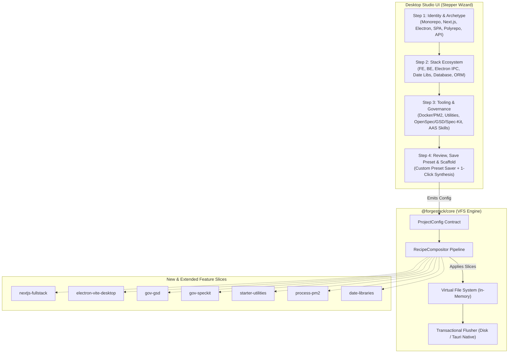

# Architectural Design: Multi-Framework Expansion, Multi-Engine AI Governance, and 4-Step Stepper Studio

## Architecture Overview

This change enhances ForgeStack across two primary pillars:
1. **Core Generation Engine (`@forgestack/core`)**: Adds composable slices for Next.js 15, Electron Desktop (`electron-vite`), GSD (`gsd-core`), GitHub Spec-Kit, PM2 process management, date utility libraries (`dayjs`, `date-fns`, `moment`), and production helper packs (Axios interceptor, JWT generator, password hasher).
2. **Desktop Studio UI (`@forgestack/desktop`)**: Replaces the single-view dense configurator with a 4-step progressive disclosure wizard that starts with clean empty slots, contextually exposes relevant stack choices, provides a VS Code-grade toolbar for staging files, and supports saving reusable custom presets to `localStorage`.



---

## Detailed Component Specifications

### 1. Electron Architecture & Security Isolation

To satisfy the user's explicit requirement:
```ts
const electronAPI: ElectronAPI = {
  profile: {
    create: (input: CreateProfileInput) => ipcRenderer.invoke('profile:create', input),
  },
  log: {
    getAll: () => ipcRenderer.invoke('log:getAll'),
  }
};
contextBridge.exposeInMainWorld("electronAPI", electronAPI);
```

#### Security Model
- **`nodeIntegration: false`**: Never expose Node.js primitives or raw `require()` to the renderer window.
- **`contextIsolation: true`**: Ensure renderer JavaScript cannot access the preload script's prototype chain or global scope.
- **`webSecurity: true`**: Prevent unauthorized cross-origin resource requests.
- **Type-safe IPC Contracts**: Preload exposes strongly-typed invoke wrappers with zero direct access to `ipcRenderer.sendSync` or unvalidated listeners.
- **File Structure (`electron-vite`)**:
  ```
  electron-app/
  ├── electron.vite.config.ts
  ├── package.json
  ├── tsconfig.json
  ├── src/
  │   ├── main/
  │   │   ├── index.ts        # Window lifecycle & ipcMain.handle handlers
  │   │   └── ipc/
  │   │       ├── profile.ts  # profile:create handler
  │   │       └── log.ts      # log:getAll handler
  │   ├── preload/
  │   │   ├── index.ts        # contextBridge.exposeInMainWorld("electronAPI", ...)
  │   │   └── index.d.ts      # global Window.electronAPI typings
  │   └── renderer/
  │       ├── index.html
  │       ├── src/
  │       │   ├── App.tsx     # React 19 UI calling window.electronAPI
  │       │   └── main.tsx
  ```

---

### 2. Multi-Engine AI Governance Specification

Developers can select between three complementary specification standards:

1. **OpenSpec (`openspec`)**:
   - Directory: `openspec/`
   - Files: `config.yaml`, `specs/`, `changes/`
   - Workflows: `.agents/workflows/opsx-propose.md`, `opsx-apply.md`, `opsx-sync.md`.
2. **Open-GSD (`gsd`)**:
   - Directory: `gsd/`
   - Files:
     - `gsd/PROJECT.md`: System overview, core goals, and non-negotiable tech stack constraints.
     - `gsd/REQUIREMENTS.md`: Prioritized requirement matrix (`[P0]`, `[P1]`, `[P2]`) with acceptance tests.
     - `gsd/ROADMAP.md`: Phase sequencing and milestone definition.
     - `gsd/STATE.md`: Real-time active task queue, current agent ownership, and blocker register.
   - Workflows: `.agents/workflows/gsd-plan.md`, `gsd-execute.md`, `gsd-verify.md`.
3. **GitHub Spec-Kit (`speckit`)**:
   - Directory: `.spec-kit/`
   - Files:
     - `.spec-kit/constitution.md`: Core architectural tenets, coding standards, and forbidden patterns.
     - `.spec-kit/specs/feature-template.md`: Acceptance Criteria (Given/When/Then), interface contracts.
     - `.spec-kit/tasks/task-runner.md`: Granular work breakdown checklist.
     - `.spec-kit/prompts/implement.prompt.md`: AI agent prompt for guided feature authoring.
   - Workflows: `.agents/workflows/speckit-spec.md`, `speckit-implement.md`, `speckit-review.md`.

---

### 3. Production Utility Helper Packs

#### Frontend Utilities (`src/lib/`):
- **`axios-client.ts`**:
  - Request interceptor: Automatically attaches `Authorization: Bearer <token>` from token manager.
  - Response interceptor: Catches `401 Unauthorized`, initiates a single flight token refresh request, queues waiting calls, and replays on success; redirects to login on failure.
  - Exponential backoff retry for network timeouts (`ECONNABORTED`, 5xx).
- **`token-manager.ts`**:
  - Encapsulated access token and refresh token storage with memory cache and optional persistent fallback.
- **`api-gateway.ts`**:
  - Typed HTTP methods (`get`, `post`, `put`, `del`) returning `{ data, error, status }`.
- **`index.ts`**:
  - Unified barrel export for all client helpers:
    ```ts
    export * from './axios-client.js';
    export * from './token-manager.js';
    export * from './api-gateway.js';
    ```

#### Backend Utilities (`src/utils/`):
- **`token-generator.ts`**:
  - Generates rotating JWT access token (15m expiry) and refresh token (7d expiry) pairs using Node's native `crypto` or standard JWT libraries.
  - Constant-time signature verification preventing timing attacks.
- **`password-hasher.ts`**:
  - Secure cryptographic password hashing with salting via `node:crypto` (`scryptSync` / `pbkdf2Sync`).
- **`api-response.ts`**:
  - Uniform envelope factories: `ApiResponse.success(data, meta)` and `ApiResponse.error(message, code, details)`.
- **`index.ts`**:
  - Unified barrel export for all server helpers.

---

### 4. 4-Step Stepper Studio UX

The left-side panel transitions from an overwhelming single view to a disciplined 4-stage stepper:

| Step | Title | Purpose & Controls |
| :--- | :--- | :--- |
| **1** | **Project Identity & Archetype** | Project name, path browser, package manager (`pnpm`/`npm`/`yarn`/`bun`), and archetype tile selector: Monorepo, Polyrepo, Next.js 15, Electron Desktop, React SPA, Clean API. Starts with empty slot. |
| **2** | **Stack Ecosystem** | Dynamically adapts to Step 1. Displays only relevant framework tiles (React/Next.js/Fastify/Express), UI styling (Tailwind v4), UI extras, Date libraries (`dayjs`/`date-fns`/`moment`), Database (Postgres/Mongo/SQLite), and ORM (Drizzle/Prisma/Mongoose). |
| **3** | **DevOps, Utilities & AI Governance** | Process manager (Docker vs PM2 vs None), Utilities (Axios interceptor, JWT generator), AI governance engine (OpenSpec vs GSD vs Spec-Kit), and AAS playbooks checklist. |
| **4** | **Review, Preset Saver & Scaffold** | Full architecture summary checklist, "Save as Reusable Custom Preset" modal/storage, and one-click disk synthesis with live progress logs. |

---

### 5. VS Code-Style Virtual Staging Toolbar

Matching the user's provided UI reference (`media_1794893503628_791b7a79.png`):
- **Action Icons in Tree Header**:
  1. `New File (+)`: Opens an inline input to create a custom staged file with boilerplate content.
  2. `New Folder (+)`: Opens an inline input to create a custom staged folder.
  3. `Refresh (↺)`: Re-runs `generateProjectVfs(config)` to sync the live tree with active settings.
  4. `Collapse/Expand All (⊟ / ⊞)`: Toggles tree recursion state.
- **Search & Filter**: Real-time fuzzy filtering of file paths.
- **File Inspector**: Modal with syntax-highlighted code preview on file selection.
