# Technical Design: Next-Gen Archetypes, Production Primitives, MCP Integration & Core Alignment

## Context & Architecture Overview

ForgeStack uses an ordered pipeline of **Additive Feature Slices** executed against an in-memory **Virtual File System (VFS)**. This design document establishes the architectural blueprints for fixing internal alignment issues, introducing 4 new archetypes, adding 4 production primitives, and delivering an AI Model Context Protocol (MCP) server package.

```mermaid
graph TD
    subgraph Core Pipeline Execution Order
        M[kernel-monorepo / kernel-standalone] --> SP[shared-packages]
        SP --> FE[frontend-slices: vite / nextjs / electron / tauri]
        FE --> UI[ui-slices: tailwind / ui-extras / state]
        UI --> RPC[contracts-rpc: trpc / shared-dto]
        RPC --> BE[backend-slices: clean-modular / hono / workers]
        BE --> AUTH[auth-slice: better-auth]
        AUTH --> DB[database-slices: postgres / mongodb / sqlite]
        DB --> TOOL[devops-testing: playwright / ci-workflows / docker / pm2]
        TOOL --> GOV[ai-governance: rules / mcp-server / gsd / speckit]
    end
```



---

## 1. Core Fixes & Architectural Realignment

### 1.1 Hono Implementation (`packages/core/src/slices/backend/hono.ts`)
- Instead of overloading `clean-modular.ts` with ternary branches, extract or branch cleanly for Hono:
- **Dependencies**: `hono: ^4.7.0`, `@hono/node-server: ^1.13.8`, `@hono/zod-validator: ^0.4.2`.
- **Server Entry (`src/server.ts`)**:
  ```typescript
  import { serve } from '@hono/node-server';
  import { Hono } from 'hono';
  import { cors } from 'hono/cors';
  import { logger } from 'hono/logger';
  import { secureHeaders } from 'hono/secure-headers';
  import { env } from './config/env.js';

  export const app = new Hono();
  app.use('*', logger());
  app.use('*', secureHeaders());
  app.use('*', cors({ origin: env.CORS_ORIGIN, credentials: true }));

  app.get('/api/health', (c) => c.json({ status: 'ok', runtime: 'hono' }));

  serve({ fetch: app.fetch, port: env.PORT }, (info) => {
    console.log(`Hono server running on port ${info.port}`);
  });
  ```

### 1.2 SQLite Integration (`packages/core/src/slices/database/sqlite.ts`)
- **Dependencies**: `better-sqlite3: ^11.8.1`, `@types/better-sqlite3: ^7.6.12`, `drizzle-orm: ^0.39.1`.
- **Database Client (`src/database/client.ts`)**:
  ```typescript
  import Database from 'better-sqlite3';
  import { drizzle } from 'drizzle-orm/better-sqlite3';
  import * as schema from './schema.js';
  import { env } from '../config/env.js';

  const sqlite = new Database(env.DATABASE_URL.replace('file:', ''));
  sqlite.pragma('journal_mode = WAL');
  export const db = drizzle(sqlite, { schema });
  ```
- **Schema & Migrations**: Configures `drizzle.config.ts` targeting dialect `sqlite`.

### 1.3 Next.js Full-Stack Database Unification
- Refactor `postgresSlice`, `mongodbSlice`, and `sqliteSlice` condition checks from:
  `if (config.backend.framework === 'none' || ...)`
  to:
  ```typescript
  const isEligible =
    config.backend.framework !== 'none' ||
    config.topology === 'nextjs-fullstack' ||
    config.frontend.framework === 'nextjs';
  if (!isEligible || config.backend.database !== 'postgres') return;
  ```
- For Next.js, files are generated in `src/db/` or `db/` with database connection pooling compatible with React Server Components (RSC) and Server Actions.

---

## 2. High-Value Archetypes

### 2.1 Native Tauri v2 Desktop Archetype (`topology: 'tauri-desktop'`)
- **File Structure**:
  ```text
  ├── src-tauri/
  │   ├── Cargo.toml          # Rust dependencies (tauri v2, serde, serde_json)
  │   ├── tauri.conf.json     # App identifiers, window sizes, security CSP
  │   ├── capabilities/       # Tauri v2 permission system (core:default, dialog, fs)
  │   └── src/
  │       ├── lib.rs          # Tauri command registration
  │       └── main.rs         # Native executable entrypoint
  ├── src/                    # React 19 + Tailwind CSS v4 frontend
  │   ├── App.tsx             # UI consuming window.__TAURI__.core.invoke()
  │   └── main.tsx
  ├── package.json
  └── vite.config.ts          # Vite configured with strict port 1420 & clearScreen
  ```
- **Security**: Context isolation, explicit capabilities JSON (`core:default`, `dialog:default`), and zero arbitrary shell execution.

### 2.2 AI-Native Agent / RAG Archetype (`topology: 'ai-agent-rag'`)
- **Dependencies**: `ai: ^4.1.0`, `@ai-sdk/openai: ^1.1.0`, `pgvector: ^0.2.0`.
- **Components**:
  - `apps/api/src/ai/vector-store.ts`: Drizzle schema with `vector('embedding', { dimensions: 1536 })` and cosine similarity index (`hnsw`).
  - `apps/api/src/ai/agent-service.ts`: Tool-calling loop equipped with validation contracts.
  - `apps/api/src/modules/chat/chat.routes.ts`: Streaming SSE endpoint returning tokens in real time.
  - `apps/web/src/hooks/use-agent-chat.ts`: React hook handling SSE streaming, markdown rendering, and abort controllers.

### 2.3 True Micro-Frontend Federation (`topology: 'micro-frontend'`)
- **Structure**:
  ```text
  ├── apps/
  │   ├── shell/                # Host application (@module-federation/vite)
  │   │   ├── src/App.tsx       # Dynamic remote loader and navigation bar
  │   │   └── vite.config.ts    # Federation host configuration
  │   ├── remote-dashboard/     # Remote app exposing './DashboardWidget'
  │   │   └── vite.config.ts    # Federation remote configuration
  │   └── api/                  # Shared backend gateway
  └── packages/
      ├── event-bus/            # Typed CustomEvent / BroadcastChannel bus
      └── ui/                   # Shared UI primitives
  ```

### 2.4 Event-Driven & Distributed Worker Archetype (`topology: 'distributed-worker'`)
- **Dependencies**: `bullmq: ^5.40.0`, `ioredis: ^5.5.0`, `ws: ^8.18.0`.
- **Structure**:
  - `src/server.ts`: HTTP API receiving jobs and pushing to BullMQ queue.
  - `src/worker.ts`: Standalone headless consumer processing queued jobs with concurrency controls and exponential retry backoff.
  - `src/ws/gateway.ts`: WebSocket notification server pushing job completion events to connected clients.

---

## 3. Production Primitives & Core Tool Packages

### 3.1 Authentication Primitive (Better-Auth)
- **Why Better-Auth**: Modern, type-safe, framework-agnostic TypeScript auth that works seamlessly with Drizzle, Prisma, Next.js, Fastify, and Express without vendor lock-in.
- **Scaffolded Modules**:
  - `src/auth/auth.ts`: Better-Auth server instance with email/password and session plugins.
  - `src/auth/client.ts`: Typed React client hooks (`useSession`, `signIn`, `signUp`).
  - Database schema tables: `user`, `session`, `account`, `verification`.

### 3.2 End-to-End Type Safety (tRPC v11)
- **Monorepo Integration**:
  - `packages/api-client/src/trpc.ts`: Client library exposing `createTRPCReact<AppRouter>()`.
  - `apps/api/src/trpc/router.ts`: Root router exporting `AppRouter` type.
  - Eliminates manual HTTP client boilerplate in favor of compile-time type verification.

### 3.3 End-to-End Testing (Playwright)
- `playwright.config.ts`: Cross-browser setup (Chromium, Firefox, WebKit) with local webserver startup command (`pnpm dev`).
- `tests/e2e/smoke.spec.ts`: End-to-end tests verifying:
  - Frontend loads without console errors.
  - Health check endpoint `/api/health` returns status 200.

### 3.4 CI/CD DevOps Pipeline
- `.github/workflows/ci.yml`:
  ```yaml
  name: CI Matrix
  on: [push, pull_request]
  jobs:
    validate:
      runs-on: ubuntu-latest
      steps:
        - uses: actions/checkout@v4
        - uses: pnpm/action-setup@v4
        - uses: actions/setup-node@v4
          with: { node-version: 22, cache: 'pnpm' }
        - run: pnpm install --frozen-lockfile
        - run: pnpm turbo run lint typecheck test build
  ```

---

## 4. Next-Gen AI Governance: Model Context Protocol (MCP)

### 4.1 `@repo/mcp-server` Package Blueprint
- Standard package inside monorepo (`packages/mcp-server`):
  - **Dependencies**: `@modelcontextprotocol/sdk: ^1.5.0`, `zod: ^3.24.2`.
  - **Exposed Tools**:
    - `inspect_database_schema`: Returns active Drizzle/Prisma schema definitions to the agent.
    - `run_spec_verification`: Runs `openspec validate` and reports violations.
    - `check_route_health`: Dispatches test requests against the local API and returns structured health payloads.
  - **Configuration**: Generates `.cursor/mcp.json` and Claude Desktop configuration snippets so agents connect automatically.

---

## 5. Security & Migration Considerations

1. **Database Credentials**: SQLite uses zero-network local file access. Postgres/Mongo configurations enforce sanitized passwords in `.env.example` and reject hardcoded default credentials in production modes.
2. **Backward Compatibility**: All existing configs continue to function with default values. New enums and options are strictly additive.
3. **Rollback Resilience**: In-memory VFS commits only when all slices succeed; any failure triggers the `TransactionalFlusher` rollback routine, leaving zero partial state on disk.
