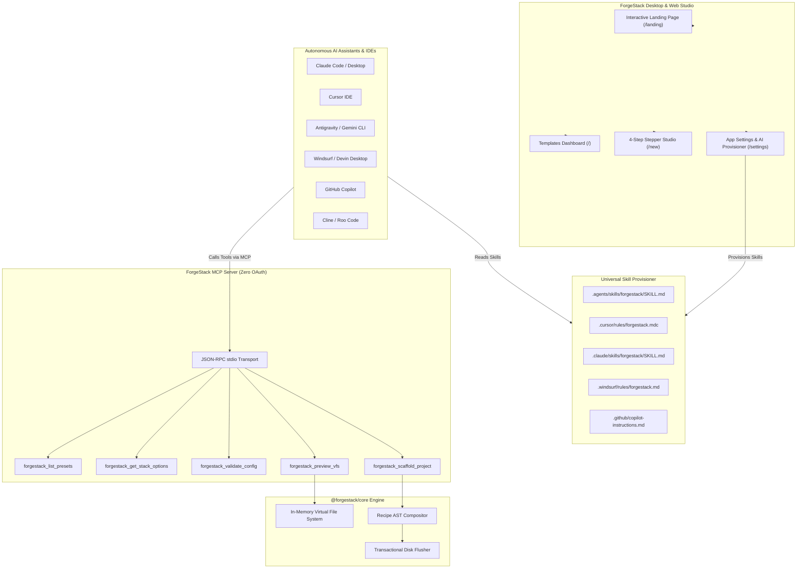

# Architectural Design: Universal AI Skills, Direct MCP Server, and Interactive Showcase Landing

## Architecture Overview

This change introduces three major pillars to the ForgeStack ecosystem:
1. **Universal AI Agent Skills (`forgestack-agent-skills`)**: An authoritative skill definition packaged with an automated multi-agent provisioner that detects and configures all major AI assistant formats (Shared `.agents/skills`, Antigravity, Claude Code, Cursor, Windsurf, Copilot, Cline).
2. **Direct Zero-OAuth MCP Server (`@forgestack/mcp`)**: A local Model Context Protocol server communicating via standard input/output (stdio) or HTTP, exposing presets, stack introspection, Zod validation, in-memory VFS previewing, and autonomous scaffolding.
3. **Interactive Flagship Landing Page (`/landing`)**: A kinetic, highly polished marketing and showcase page modeled after the Codezy benchmark (`codezy/app/(public)/page.tsx`), featuring live stack simulators, desktop app visual artifacts, competitor comparisons, and release changelogs.



---

## Pillar 1: Universal AI Agent Skills Architecture

### 1. Skill Specification Schema (`forgestack/SKILL.md`)
The core skill file follows the GitHub/Agent Standard frontmatter:
```markdown
---
name: forgestack
description: Expert scaffolding and architecture engine for TypeScript monorepos, Next.js 15, micro-frontends, and clean modular APIs with Day-One AI Governance. Use whenever scaffolding or modifying a project with ForgeStack.
---
```
It provides the agent with:
1. **Decision Matrix**: When to choose monorepo vs polyrepo vs Next.js vs SPA.
2. **CLI Invocation Specs**:
   ```bash
   npx create-forgestack-app <project-name> \
     --topology <monorepo|separate-folders|nextjs-fullstack|standalone-fe|backend-api|electron-desktop> \
     --fe <react-vite|nextjs|none> \
     --styling <tailwind|vanilla> \
     --state <query|zustand|jotai|none> \
     --be <fastify|express|clean-modular|none> \
     --db <postgres|mongodb|sqlite|none> \
     --orm <drizzle|prisma|mongoose|none> \
     --auth <better-auth|none> \
     --install \
     --git
   ```
3. **Architecture Guidance**: Explains the in-memory VFS, AST composition rules, and Day-One AI Governance engines (`openspec`, `gsd`, `speckit`).

### 2. Multi-Agent Distribution Map
The automated provisioner inspects the workspace and writes the exact compatible configuration across target formats:

| Agent Ecosystem | Target Destination | File Format |
| :--- | :--- | :--- |
| **Shared / Universal** | `.agents/skills/forgestack/SKILL.md` | Standard Agent Skill Markdown |
| **Antigravity** | `.agents/skills/forgestack/SKILL.md` / `~/.gemini/antigravity/` | Native Skill YAML/Markdown |
| **Claude Code** | `.claude/skills/forgestack/SKILL.md` & `CLAUDE.md` | Skill Doc + Root Guidelines |
| **Cursor** | `.cursor/rules/forgestack.mdc` | Cursor Rule with frontmatter glob |
| **Windsurf / Devin** | `.windsurf/rules/forgestack.md` | Windsurf Rule specification |
| **GitHub Copilot** | `.github/copilot-instructions.md` | Copilot Workspace Instructions |
| **Cline / Roo Code** | `.clinerules` | System prompt instruction block |

Both the CLI (`packages/cli/src/commands/ai-skills.ts`) and Desktop GUI (`packages/desktop/src/components/settings/AppSettingsPage.tsx`) invoke this shared generator.

---

## Pillar 2: Zero-OAuth Model Context Protocol (MCP) Server

### 1. Protocol & Transport
- **Transport**: Standard Input/Output (`stdio`) conforming to JSON-RPC 2.0.
- **Dependencies**: `@modelcontextprotocol/sdk`.
- **Zero Authentication**: Runs locally within the developer's execution context. No OAuth tokens, external API keys, or webhooks needed.

### 2. Exposed MCP Tool Specifications

#### `forgestack_list_presets`
- **Description**: Returns all built-in curated architectural blueprints (Monorepo, Next.js 15, Electron, Polyrepo, Fastify API) with their complete configuration structures.
- **Input**: None.
- **Output**: JSON array of preset descriptors and metadata.

#### `forgestack_get_stack_options`
- **Description**: Returns all valid enum options and capability matrices across topologies, frameworks, databases, and AI governance engines.
- **Input**: None.
- **Output**: JSON schema map of all available options.

#### `forgestack_validate_config`
- **Description**: Validates a proposed `ProjectConfig` JSON against ForgeStack's Zod schema. Flags invalid combinations (e.g., Drizzle with MongoDB, or Electron without a renderer).
- **Input Schema**:
  ```json
  {
    "type": "object",
    "properties": {
      "config": { "type": "object" }
    },
    "required": ["config"]
  }
  ```
- **Output**: `{ valid: boolean, errors?: string[], warnings?: string[], recommendations?: string[] }`.

#### `forgestack_preview_vfs`
- **Description**: Executes the AST compositor in-memory and returns the synthesized file tree with file counts and select file contents without writing to disk.
- **Input Schema**:
  ```json
  {
    "type": "object",
    "properties": {
      "config": { "type": "object" },
      "includeContent": { "type": "boolean" }
    },
    "required": ["config"]
  }
  ```
- **Output**: `{ fileCount: number, tree: TreeNode[], files: Array<{ path: string, size: number }> }`.

#### `forgestack_scaffold_project`
- **Description**: Performs end-to-end atomic project generation onto physical disk with pre-flight checks and optional post-install hooks.
- **Input Schema**:
  ```json
  {
    "type": "object",
    "properties": {
      "config": { "type": "object" },
      "targetPath": { "type": "string" },
      "force": { "type": "boolean" }
    },
    "required": ["config", "targetPath"]
  }
  ```
- **Output**: `{ success: boolean, filesWritten: number, targetPath: string, message: string }`.

---

## Pillar 3: Interactive Showcase Landing Page Architecture

### 1. Visual Aesthetics & Design Benchmark
Following the Codezy benchmark (`/home/dev/Documents/Kungfu/Lanet/Codezy/codezy/app/(public)/page.tsx`), the page employs:
- **Kinetic Typography & Motion**: Floating ambient gradients, velocity marquees, and interactive hover states.
- **Dark/Light Cohesion**: Inherits ForgeStack's 4 visual palettes (`theme-dark`, `theme-midnight`, `theme-matrix`, `theme-light`).
- **High-Fidelity Product Visuals**: Crisp desktop studio screenshots showcasing the Monaco workspace and template hub.

### 2. Component Hierarchy

```text
packages/desktop/src/components/landing/
├── LandingPage.tsx                  // Main Container & Section Assembly
├── LandingNavbar.tsx                // Navigation with Studio link & Download CTA
├── HeroKinetic.tsx                  // Animated headline, terminal copy box, node visualizer
├── VelocityMarquee.tsx              // Smooth infinite technology stack marquee
├── InteractiveStackSimulator.tsx    // Live 4-in-1 in-browser stack toggle playground
├── DesktopAppShowcase.tsx           // Studio screenshots & feature zoom
├── FeatureSpotlight.tsx             // 4 Core Architecture Pillars (AST, VFS, Governance, Native)
├── CompetitorMatrix.tsx             // Feature-by-feature comparison table
├── ChangelogTimeline.tsx            // Interactive version history & roadmap (v1.0.0, v1.1.0)
├── DownloadInstallHub.tsx           // Linux .deb, .rpm, AppImage download & CLI command
└── LandingFooter.tsx                // Community links, docs, and copyright
```

### 3. Desktop Application Screenshots
Using client-side DOM capture and styled mockup windows:
- Studio Dashboard with Templates Grid.
- 4-Step Stepper Studio with live selection.
- Monaco-powered code editor with active TypeScript file.
- Update modal with Debian root package detection.

---

## Security & Performance Considerations

1. **MCP Security Sandbox**:
   - The MCP server only executes filesystem operations inside the explicitly supplied `targetPath`.
   - Path traversal attempts (`../`) outside designated project folders are validated and rejected.
2. **Landing Page Bundle Size**:
   - Built with code-split Vite chunking (`output.manualChunks`) to ensure the landing page does not bloat the core desktop startup bundle.
3. **No External Network Leaks**:
   - Both the MCP server and Universal Skills function 100% offline. Zero telemetry, zero external network requests.
